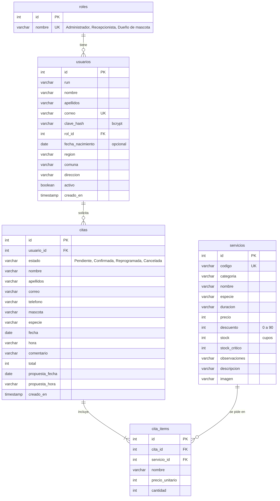
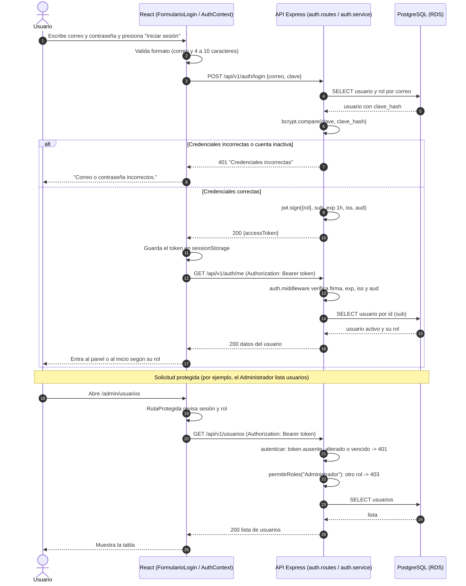

# Veterinaria San Marcos — Backend

API REST del proyecto semestral de DSY1104 Desarrollo Fullstack II (caso Forma A, Veterinaria San Marcos).

- **Sección:** 003D
- **Integrantes:** Nicolás Ortega, Martín Vásquez, Justin Galleguillos
- **Frontend (React):** https://github.com/vrown7/veterinaria-san-marcos-v2.0
- **Alcance:** usuarios con inicio de sesión JWT y roles, catálogo de servicios veterinarios y citas (flujo principal), con la regla de no confirmar una cita en un horario ya ocupado.

## Estado del trabajo

Estados: **Diseñado** (definido, sin código), **Implementado** (código listo, probado en local) y **Listo** (probado contra la base en RDS con el frontend).

| Operación | Estado | Detalle |
|---|---|---|
| Tabla de usuarios | Listo | Tablas `roles` y `usuarios` creadas en PostgreSQL (Amazon RDS) con `sql/01_tablas.sql`. Los datos siguen ahí al reiniciar el backend y las contraseñas se guardan con hash. |
| Inicio de sesión | Listo | `POST /api/v1/auth/login` busca al usuario en la tabla, comprueba el hash y entrega un JWT. Probado en Swagger contra RDS. |
| Registro (crear usuario) | Listo | `POST /api/v1/auth/register` guarda el usuario con el rol que asigna el servidor. Probado en Swagger contra RDS. |
| Crear usuario (Administrador) | Listo | `POST /api/v1/usuarios`: el Administrador crea usuarios con el rol que elige. Probado contra RDS desde el frontend y Swagger. |
| Modificar usuario | Listo | `PUT /api/v1/usuarios/{id}`: Administrador o el dueño de la cuenta; solo el Administrador cambia el rol; correo repetido da 409. Probado contra RDS desde el frontend y Swagger. |
| Listar usuarios | Listo | `GET /api/v1/usuarios` (solo Administrador) y `GET /api/v1/usuarios/{id}` (Administrador o el dueño). Probado contra RDS desde el frontend y Swagger. |
| Eliminar o desactivar usuario | Listo | `DELETE /api/v1/usuarios/{id}` desactiva la cuenta (no borra el registro); el usuario ya no puede iniciar sesión y su token deja de servir. Probado contra RDS desde el frontend y Swagger. |
| Catálogo de servicios (CRUD) | Listo | `GET` público; `POST`, `PUT` y `DELETE` solo Administrador. Código repetido da 409; no se elimina un servicio que ya está en citas (409). Probado contra RDS con el frontend en EC2. |
| Citas: crear | Listo | `POST /api/v1/citas` con sesión. El servidor calcula precios y total con el catálogo y descuenta cupos; sin cupos da 409. Probado contra RDS con el frontend en EC2. |
| Citas: listar y ver detalle | Listo | El dueño ve solo sus citas; Administrador y Recepcionista ven todas. Ver la cita de otro dueño da 403. Probado contra RDS con el frontend en EC2. |
| Citas: cambiar estado | Listo | Confirmar (personal), cancelar (personal o el dueño), proponer otro horario (personal) y aceptar la propuesta (dueño). **Regla de negocio:** no se confirma una cita en un horario ya ocupado (409). Probado contra RDS con el frontend en EC2. |
| Citas: eliminar | Listo | `DELETE /api/v1/citas/{id}` solo Administrador; devuelve los cupos. Probado contra RDS con el frontend en EC2. |
| Conexión del frontend con la API | Listo | Login, registro, sesión y administración de usuarios del frontend usan esta API. Probado con frontend y backend desplegados en EC2. |
| Conexión del catálogo y las citas con el frontend | Listo | Catálogo público, panel de servicios, confirmar solicitud, Mis citas y panel de solicitudes usan esta API. Probado con frontend y backend en EC2 y la base en RDS. |

## Decisiones técnicas

- **Node.js con Express, ejecutado en EC2.** Es el mismo lenguaje del frontend y la estructura (servidor, rutas, controladores) es la que trabajamos en la guía 18.
- **PostgreSQL en Amazon RDS**, sin acceso público. El backend se conecta con el paquete `pg` y consultas parametrizadas.
- **bcrypt** para las contraseñas. Es un algoritmo hecho para contraseñas: es lento a propósito y agrega una sal distinta a cada hash, así dos claves iguales no quedan guardadas igual. Usamos un costo de 10. OWASP lo acepta para contraseñas con un costo de 10 o más (recomienda Argon2id como primera opción).
- **jsonwebtoken** para emitir y verificar el JWT.
- **swagger-ui-express** para mostrar la documentación OpenAPI y probar las rutas desde el navegador.

Fuentes: [OWASP Password Storage Cheat Sheet](https://cheatsheetseries.owasp.org/cheatsheets/Password_Storage_Cheat_Sheet.html), [OWASP REST Security Cheat Sheet](https://cheatsheetseries.owasp.org/cheatsheets/REST_Security_Cheat_Sheet.html), [documentación de Swagger](https://swagger.io/docs/).

## Base de datos

PostgreSQL en Amazon RDS, con cinco tablas (scripts en la carpeta `sql`):

- `roles`: Administrador, Recepcionista y Dueño de mascota.
- `usuarios`: cada usuario tiene un rol (`rol_id`). El correo no se repite y la contraseña se guarda solo como hash (`clave_hash`). Al "eliminar" un usuario se deja `activo = false`, para no perder sus citas.
- `servicios`: el catálogo de la clínica. `stock` son los cupos disponibles y `codigo` no se repite.
- `citas`: la solicitud de un dueño (`usuario_id`) para su mascota, con fecha, hora, estado y total. La mascota se guarda como datos de la cita.
- `cita_items`: los servicios de cada cita, con el precio copiado al momento de pedir (si el catálogo cambia, la cita no cambia).

La regla de negocio también está en la base: un índice único impide dos citas **confirmadas** en la misma fecha y hora.

### Diagrama entidad-relación



Fuente editable: [`docs/diagrama-er.mmd`](docs/diagrama-er.mmd).

## Organización del backend

| Carpeta | Responsabilidad |
|---|---|
| `src/routes` | Define las rutas HTTP y qué middleware las protege. |
| `src/controllers` | Recibe la solicitud y devuelve la respuesta con su estado HTTP. |
| `src/services` | Reglas del negocio: validar, asignar el rol, revisar permisos, calcular precios, cupos y el horario ocupado (`citas.service.js`). |
| `src/repositories` | Acceso a datos: las consultas SQL a PostgreSQL. |
| `src/middlewares` | Seguridad: valida el JWT (401) y el rol (403). |
| `src/utils` | Validaciones de entrada y errores de la API. |
| `src/docs` | Especificación OpenAPI que muestra Swagger. |
| `sql` y `scripts` | Creación de tablas, servicios iniciales y administrador inicial (`npm run db:init`). |
| `docs` | Diagrama entidad-relación y diagrama de secuencia. |

## API

Documentación en Swagger: `http://IP_PUBLICA_EC2:3000/api/docs`

El backend corre en una instancia EC2 de AWS Academy. La dirección responde solo mientras el laboratorio está iniciado, y la IP pública cambia cada vez que se enciende la instancia: el equipo indica la IP vigente al presentar.

| Método y ruta | Quién puede | Pantalla del frontend |
|---|---|---|
| `POST /api/v1/auth/register` | Cualquiera | Registro |
| `POST /api/v1/auth/login` | Cualquiera | Iniciar sesión |
| `GET /api/v1/auth/me` | Usuario con sesión | Sesión del usuario |
| `GET /api/v1/usuarios` | Administrador | Admin: usuarios |
| `POST /api/v1/usuarios` | Administrador | Admin: nuevo usuario |
| `GET /api/v1/usuarios/{id}` | Administrador o el dueño de la cuenta | Admin: ver usuario |
| `PUT /api/v1/usuarios/{id}` | Administrador o el dueño de la cuenta | Admin: editar usuario |
| `DELETE /api/v1/usuarios/{id}` | Administrador | Admin: usuarios |
| `GET /api/v1/servicios` | Cualquiera | Inicio, Catálogo, Ofertas, Admin: servicios |
| `GET /api/v1/servicios/{id}` | Cualquiera | Detalle de servicio |
| `POST /api/v1/servicios` | Administrador | Admin: nuevo servicio |
| `PUT /api/v1/servicios/{id}` | Administrador | Admin: editar servicio |
| `DELETE /api/v1/servicios/{id}` | Administrador | Admin: servicios |
| `GET /api/v1/citas` | Usuario con sesión (el dueño ve solo las suyas) | Mis citas, Admin: solicitudes |
| `POST /api/v1/citas` | Usuario con sesión | Confirmar solicitud |
| `GET /api/v1/citas/{id}` | Personal o el dueño de la cita | Admin: ficha de la solicitud |
| `PATCH /api/v1/citas/{id}/estado` | Personal (confirmar o cancelar) o el dueño (cancelar) | Admin: ficha, Mis citas |
| `PATCH /api/v1/citas/{id}/propuesta` | Administrador o Recepcionista | Admin: ficha (proponer horario) |
| `POST /api/v1/citas/{id}/aceptar-propuesta` | El dueño de la cita | Mis citas |
| `DELETE /api/v1/citas/{id}` | Administrador | Admin: ficha |

### Regla de negocio (409)

No se confirma una cita en un horario que ya tiene otra cita confirmada. Está en `src/services/citas.service.js`
(`cambiarEstado`, `proponerHorario` y `aceptarPropuesta`) y se respalda con el índice único `citas_horario_confirmado`.
Otras respuestas 409: sin cupos suficientes al pedir una cita, código de servicio repetido, correo repetido y
eliminar un servicio que ya está en citas.

## Seguridad

- El registro siempre crea la cuenta como "Dueño de mascota". Si el cliente envía un rol, se ignora. Solo el Administrador puede cambiar el rol de alguien.
- El login responde "Credenciales incorrectas" tanto si el correo no existe como si la clave está mal.
- El JWT se firma con HS256 y lleva `sub` (id del usuario), `exp` (vence en 1 hora), `iss`, `aud` y el rol. La clave de firma está en el archivo `.env`, que no se sube al repositorio.
- En cada solicitud protegida el backend verifica la firma, la vigencia, el emisor y el destinatario, y vuelve a leer al usuario y su rol desde la base de datos.
- Un usuario que no es Administrador no puede ver ni modificar la cuenta de otra persona cambiando el id en la URL (403).
- Las respuestas nunca incluyen la contraseña ni su hash.

- CORS: solo los orígenes del frontend indicados en `CORS_ORIGEN` pueden llamar a la API desde el navegador. CORS no reemplaza la autorización: el token y el rol se revisan igual.
- En el frontend el token se guarda en `sessionStorage` (ver el README del frontend).

### Diagrama de secuencia: inicio de sesión y solicitud protegida



Fuente editable: [`docs/diagrama-secuencia-login.mmd`](docs/diagrama-secuencia-login.mmd).

Pendiente (mejora futura): límite de intentos de inicio de sesión.

## Cómo ejecutar

Requisitos: Node.js 18 o superior y una base de datos PostgreSQL. En EC2 usamos Node con nvm (guía 10).

```bash
npm install
cp .env.example .env      # completar los valores (el .env no se sube)
npm run db:init           # crea las tablas, los servicios iniciales y el administrador inicial
npm start                 # API en el puerto 3000
```

Después se abre `http://localhost:3000/api/docs` para probar las rutas.

En EC2, `CORS_ORIGEN` debe incluir la dirección pública del frontend, por ejemplo
`CORS_ORIGEN=http://localhost:5173,http://IP_PUBLICA_EC2:5173`. Si cambia la IP, se actualiza y se reinicia el backend.

## Pruebas realizadas

Probado en Swagger con el backend en EC2 y la base en Amazon RDS (16 de noviembre):

- Registro de un usuario (201), queda guardado con el rol "Dueño de mascota".
- Login con ese usuario (200 con token).
- `GET /api/v1/auth/me` con el token (200).
- Después de reiniciar el backend el login sigue funcionando (los datos persisten).

Probado antes con una base PostgreSQL local:

- Registro correcto (201), correo repetido (409) y datos inválidos (400).
- Login correcto (200 con token), clave incorrecta y correo inexistente (401 con el mismo mensaje).
- Ruta protegida sin token y con token alterado (401).
- Listar usuarios con rol Dueño de mascota (403) y con Administrador (200).
- Ver o modificar la cuenta de otra persona (403), cambiar el propio rol (403).
- Desactivar un usuario (204); después no puede iniciar sesión y su token deja de servir (401).
- Los datos siguen en la base después de reiniciar el backend.

Probado el 21 de noviembre con frontend y backend en EC2 y la base en RDS (usuarios):

- Ruta protegida sin sesión manda al login; un Dueño de mascota que entra a `/admin` vuelve al inicio con aviso.
- La sesión sigue al recargar la página y se borra al salir.
- El Administrador crea, lista, edita y desactiva usuarios desde el frontend; un correo repetido muestra el error 409.
- Una cuenta desactivada ya no puede iniciar sesión.
- `GET /api/v1/usuarios` con el token del Administrador responde 200 en Swagger.

Probado el 21 de noviembre en local (PostgreSQL y navegador) para catálogo y citas:

- Catálogo público (200); crear servicio sin token (401) y como Recepcionista (403); como Administrador (201); código repetido (409); datos inválidos (400); editar (200).
- Pedir cita sin sesión (401); con sesión (201, el total lo calcula el servidor); sin cupos (409); datos inválidos (400).
- El dueño lista solo sus citas; la Recepcionista lista todas; ver la cita de otro dueño (403).
- El dueño intenta confirmar (403). La Recepcionista confirma una cita (200) y luego otra en el mismo horario (409, regla de negocio).
- Proponer un horario ocupado (409) y uno libre (200); el dueño acepta y la cita queda confirmada.
- Cancelar devuelve los cupos. Eliminar un servicio que está en citas (409). La Recepcionista no puede eliminar citas (403); el Administrador sí (204).

Probado el 22 de noviembre con frontend y backend en EC2 y la base en RDS (catálogo y citas), desde el navegador:

- El catálogo carga los 10 servicios iniciales.
- Dos dueños piden cita en la misma fecha y hora; cada uno ve solo la suya en "Mis citas".
- La Recepcionista confirma la primera; al confirmar la segunda aparece el 409 "Ese horario ya tiene una cita confirmada". Propone las 10:30 y el dueño acepta: la cita queda confirmada.
- El Administrador crea y edita un servicio; eliminar un servicio que está en citas muestra el 409.
- Swagger muestra Autenticación, Usuarios, Catálogo y Citas.

## Mejoras futuras

- Límite de intentos de inicio de sesión.
- CRUD de categorías, reportes e historial en el backend (fuera del alcance de la EP3).
